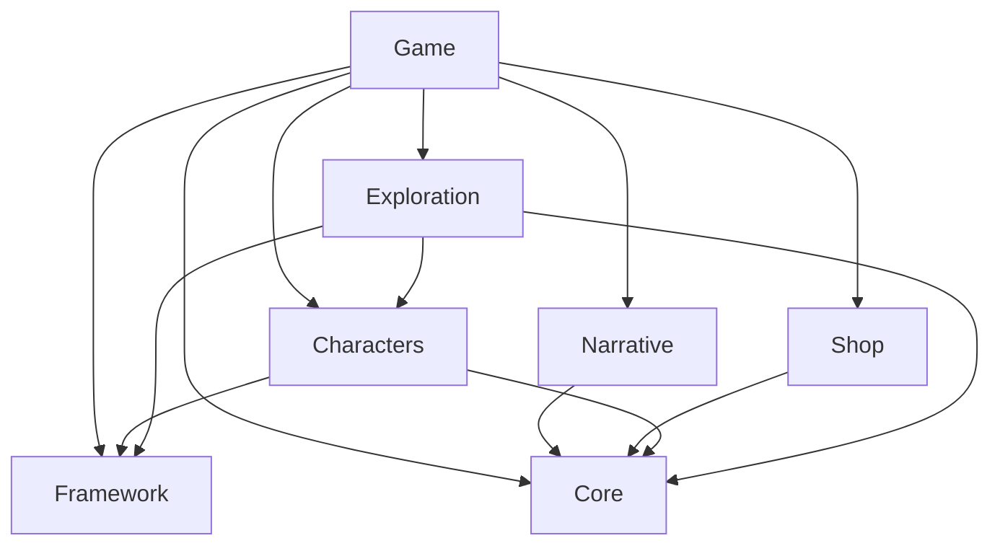

# Pawn Shop Game — Architecture

**Document status:** approved solution organization with proposed future gameplay contracts, grounded in `agents.md` and the requested structural refactor.  
**Prepared:** 2026-10-24.  
**Implementation status:** eight-project organization verified against the repository. M01's existing lifecycle is implemented; desktop lifecycle/resource acceptance remains pending. Later gameplay APIs below remain reference designs. See [verification evidence](docs/VERIFICATION_M01.md).

## 1. Purpose, sources, and authority

This document describes how to build the game as a small, understandable C#/MonoGame application: a title screen, a persistent game session, reusable gameplay systems, and a thin presentation layer. It is not an instruction to implement every system at once.

The companion documents divide responsibility:

| Document | Owns |
| --- | --- |
| Repository `AGENTS.md` | Durable engineering rules, authorization boundaries, and verification expectations |
| [GAME_DESIGN.md](GAME_DESIGN.md) | Player experience, gameplay rules, characters, progression, and proposed story content |
| This document | Ownership, dependencies, contracts, lifecycle, persistence, and technical invariants |
| [ROADMAP.md](ROADMAP.md) | Sequenced work, acceptance criteria, and evidence required to finish a milestone |

This document, GAME_DESIGN.md, ROADMAP.md, and [agents.md](agents.md) live at the repository root. Verification records live in docs/. The root instruction file retains its existing lowercase filename.

### Source coverage

| Source | Requirements carried forward |
| --- | --- |
| Supplied `agents.md`, sections 1–16 | Product scope; dependency direction; common inventory; transactions; lifetimes; dialogue/quests; robots; art; saves; first milestone |
| “Pawnshop Game Idea,” 2026-09-13, available project context | Cozy pawn-shop premise and a pixel-art game presentation |
| “Generate Walking Spritesheets,” 2026-10-09, available excerpts/history | C#/MonoGame; improvable junk piles; salvage/restore loop; abandoned malls; monster-only combat |
| “Pawn Shop Robot Concept” and “Image generation failed,” 2026-10-22 onward, available excerpts/history | Distinct large mech and small companion; separate rider rendering; expressive reactions; less-creepy core; overconfidence until challenged |
| Current architecture and tooling discussion | Start-screen-first; reusable components; common inventory; authored conversation/quests; existing repository rather than a replacement project |

History retrieval was partial, not a complete export of every chat in the project folder. The instruction file and explicit user requests take precedence over conflicting historical suggestions. The requested eight-project organization supersedes the earlier layout proposal. Sprite metrics, character names, and plot ideas remain proposals; implementation evidence is recorded separately.

### How to interpret decisions

- **Established:** explicitly required by `agents.md` or clear user requests. Preserve these unless the user changes them.
- **Proposed baseline:** a concrete, reversible design chosen here to make implementation possible. Validate it in its milestone; it is not retrospectively approved canon.
- **Open:** a product or technical choice that needs evidence or a user decision before consequential implementation.

Established constraints include local single-player C#/MonoGame, reusable systems, a title screen independent of gameplay, three separate player/mech/companion entities, a visibly smaller companion, authored narrative, and no human combat opponents. Humanoid monsters are excluded except skeletons. Multiplayer, runtime AI dialogue, online services, telemetry, modding infrastructure, and a general-purpose engine are outside scope.

## 2. Technical foundation and solution boundaries

### 2.1 Stack and implementation posture

Use the SDK, target framework, MonoGame platform target, content workflow, test framework, and package versions actually found in the repository. “Mono” in earlier conversation is treated as the C#/MonoGame direction, not a requirement to install an additional legacy runtime. Do not change platform targets or replace the framework as a documentation side effect.

Keep gameplay headless-testable. Domain data may contain asset IDs but never `Texture2D`, `SpriteBatch`, graphics devices, audio instances, or a `ContentManager`. Ordinary value types and standard-library math are sufficient; building a replacement mathematics library is not a prerequisite.

Use explicit construction at bootstrap. A dependency-injection container is optional, not an architectural requirement. No global mutable service locator, whole-world dependency passed to every object, or inherited Twitch-bot architecture is required.

### 2.2 Approved solution layout

The requested structural refactor establishes `PawnShopSimulator.sln` and eight actual C# projects at the repository root. It supersedes the earlier Domain/Application/Infrastructure proposal and the initial three-project M01 organization. Future-system folders are retained with `.gitkeep`; their existence does not mean those systems are implemented.

| Project | Responsibility | PawnShop references |
| --- | --- | --- |
| `PawnShop.Framework` | Reusable infrastructure: entities/components/systems, scenes, input, UI, events, rendering, audio; no game rules | None |
| `PawnShop.Core` | Shared gameplay rules/models, world state, atomic operations, neutral persistence contracts/storage | None currently; neutral Framework contracts permitted if needed |
| `PawnShop.Narrative` | Dialogue, quests, relationships, story flags, progression | Core |
| `PawnShop.Characters` | Character AI/behavior, movement/combat, player, mech, companion | Core, Framework |
| `PawnShop.Shop` | Customers, appraisal, restoration, displays, shop transactions using Core transactions | Core |
| `PawnShop.Exploration` | Dungeons, salvage, monsters, hazards, eventual generation | Core, Characters, Framework |
| `PawnShop.Game` | MonoGame executable; Bootstrap composition and lifecycle; concrete Screens and Content | All six production libraries |
| `PawnShop.Tests` | Existing executable regression runner; tests reference the projects they exercise | Framework, Core, Game currently |



Arrows show current compile-time dependencies. Framework references no PawnShop project. Core currently has no project or package dependencies, keeping its rules independent of graphics. Features never reference Game. Framework and Game retain the same MonoGame DesktopGL 3.8.4.1 package; sharing that package introduces no new backend. All projects retain net10.0 and SDK 10.0.401. No future gameplay feature was added by this refactor.

Required folders, relative to each project directory:

| Project | Feature folders |
| --- | --- |
| Framework | `Entities`, `Components`, `Systems`, `Scenes`, `Input`, `UI`, `Events`, `Rendering`, `Audio` |
| Core | `Inventory`, `Items`, `Interactions`, `Conditions`, `Effects`, `Transactions`, `Economy`, `World`, `Persistence` |
| Narrative | `Dialogue`, `Quests`, `Relationships`, `StoryFlags`, `Progression` |
| Characters | `AI`, `Behaviors`, `Movement`, `Combat`, `Player`, `Mech`, `Companion` |
| Shop | `Customers`, `Appraisal`, `Restoration`, `Displays`, `Transactions` |
| Exploration | `Dungeons`, `Salvage`, `Monsters`, `Hazards`, `Generation` |
| Game | root `Program.cs` and `PawnShopGame.cs`; `Bootstrap`, `Screens`, `Content` |
| Tests | `Framework`, `Inventory`, `Interactions`, `Dialogue`, `Quests`; existing lifecycle tests at the project root |

`GameSession` and `ApplicationFlow` live under `Game/Bootstrap`. The former owns the current Core room state; the latter owns creation/disposal, UI commands, and simulation scheduling. `Core/World/RoomState` owns the existing clock/bell fixture and immutable `RoomView`. Reusable `Menu<TCommand>` and input models live in Framework; game-specific menu commands stay in Game/Screens. Concrete title, room, and menu drawing lives under Game/Screens, using Framework rendering resources. Program and PawnShopGame only bootstrap and drive these pieces.

The tests retain the dependency-free console runner. They reference Game's graphics-free Bootstrap classes for lifecycle tests without constructing PawnShopGame, a window, or graphics resources. Framework menu/input tests are under Tests/Framework. Run `dotnet run --project PawnShop.Tests/PawnShop.Tests.csproj --no-build` after building the solution; `dotnet test` does not execute this runner.

`Game/Content` is currently an empty retained folder. M01's original code-authored placeholder shapes/font/floor are compiled by the C# build; no MGCB/XNB workflow has been introduced. Build with `dotnet restore PawnShopSimulator.sln` and `dotnet build PawnShopSimulator.sln --no-restore`. Launch with `dotnet run --project PawnShop.Game/PawnShop.Game.csproj --no-build`.

### 2.3 Definition, state, operation, and presentation

These four concepts must remain distinct:

| Concept | Example | Lifetime and ownership |
| --- | --- | --- |
| Definition | What a radio is, a repair recipe, a dialogue graph | Validated, effectively immutable content catalog |
| Runtime state | This radio's damage; this player's accepted quest | One game session; explicit persistent owner |
| Operation | Transfer this radio; buy it; complete a quest exchange | Owning feature command using Core rules/transactions; Game/Bootstrap wires cross-feature workflows |
| Presentation | Radio icon; condition bar; choice text; startled animation | Read models and disposable scene/UI resources |

`IReadOnlyList<ItemInstance>` is not an immutable read model if each instance can still be edited. Return immutable value snapshots, immutable nested collections, or deliberately read-only projections that cannot expose a mutation path.

## 3. Identity, state ownership, and reusable capabilities

Use strongly distinguished IDs conceptually: `EntityId`, `ItemInstanceId`, `InventoryId`, `LocationId`, `DungeonRunId`, `DefinitionId`, `QuestId`, `DialogueId`, `OperationId`, and `ClaimId`. Their exact implementation follows repository conventions. Display text and collection indexes are never persistent identities.

A content ID such as `item.radio` identifies a definition. Each physical radio has its own instance ID. A repair changes that instance; it does not quietly create a second radio.

### 3.1 Authoritative ownership map

| Mutable state | Authoritative owner | Consumers receive |
| --- | --- | --- |
| Unique item properties and current location | Session item/ownership store, changed through approved item operations | `ItemView`, `OwnershipView` |
| Inventory contents, capacities, reservations | Inventory state, coordinated with the ownership store | `InventoryView` and availability results |
| Wallet balances and shop listings | Economy/shop state through transaction handlers | `Money`, listing/quote snapshots |
| Restoration job and reservation state | Restoration state through job operations | Job progress and collection availability |
| Position, facing, damage, statuses | Actor state under the simulation owner | Actor/world snapshots |
| Rider/vehicle control relationship | Mount relationship state | Control and attachment views |
| Dialogue cursor and participant binding | Current dialogue session | `DialogueView` |
| Quest progress, claims, relationships, story facts | Narrative state through registered operations | Journal/condition read models |
| Clock and day progression | Session clock | Read-only time values |
| Location changes and dungeon instance state | Session world-state store; active location systems operate on its state | Location/run snapshots |

Indexes may speed up queries, but they are derived or updated in the same transaction as their authoritative source. Inventory lists, world pickup entities, equipment, shelves, and workstation slots must not become independent ownership ledgers.

### 3.2 Reusable capabilities, not a speculative ECS

An entity is a stable identity plus the state/capabilities it actually needs. Suggested capabilities include transform, movement, collision footprint, interaction provider, damage receiver, inventory reference, mount seat, attachment, and animation intent. They can be ordinary composed classes or structs; a full ECS framework is not required.

| Entity | Reused capabilities | Specialized behavior |
| --- | --- | --- |
| Player | Movement, collision, interaction, inventory reference, animation | Input-controlled actor; rider relationship |
| Large mech | Movement, collision, damage, cargo inventory, attachment points | Pilot control; salvage/combat actions |
| Small companion | Follow movement, interaction, reactions, animation | Overconfident chatter, assistance, comic dizziness |
| Customer/NPC | Movement if needed, dialogue, interaction, optional inventory | Buying/selling preferences and schedules |
| Monster | Movement, collision, damage, animation | Simple readable combat behavior; no human opponents |
| Junk pile/container | Interaction, inventory or search state | Search progress, material profile, renewal policy |
| Workstation | Interaction, inventory reference, job state | Recipes and time-based processing |

Validate capability requirements when constructing/spawning an entity. A seat requires a vehicle and attachment definition; a moving collider requires a transform; a job requires a valid station and recipe. Report missing prerequisites with the entity/definition ID, not a silent no-op.

## 4. Application, session, location, and overlay lifetimes

### 4.1 Four distinct lifetimes

| Scope | Owns | Ends when |
| --- | --- | --- |
| Application | Window/device, global settings, title UI, save-slot catalog, composition root | Application exits |
| Game session | Player/robots, inventory, economy, narrative, simulation clock, world changes | Return to title or successful replacement by another session |
| Active location | Live local systems, spatial indexes, scene-specific resource leases | Successful location transition |
| Overlay/conversation | Focus/input capture, scoped pause request, local presentation state, subscriptions | Overlay closes or its session is disposed |

The title screen must render without a live `GameSession`. New Game creates fresh state; Continue first validates a selected save. Only one session is active. A failed load must not dispose an existing usable session or overwrite its save.

The application state flow is bootstrap → title → loading/preparation → playing → title or exit. Pause is an overlay, not a second game session. Location changes replace active location presentation/systems, not the persistent player, inventories, or quest journal.

### 4.2 Proposed lifecycle contracts

The following C#-style signatures describe intent. Supporting types are conceptual and must be adapted to the actual repository; these are not claimed compilable library APIs.

```csharp
interface IGameSessionService
{
    SessionView? Current { get; }
    Task<Result<SessionId>> StartNewAsync(NewGameOptions options);
    Task<Result<SessionId>> LoadAsync(SaveSlotId slot);
    Task<Result<SaveReceipt>> SaveAsync(SaveSlotId slot);
    Result<Unit> ReturnToTitle(ReturnPolicy policy);
}

interface IScene
{
    void Enter();
    void HandleInput(InputFrame input, InputConsumption consumed);
    void UpdatePresentation(PresentationTime time);
    void Draw(RenderContext render); // Presentation project only.
    void Exit();
}

interface ILocationTravel
{
    Availability CanTravel(TravelRequest request);
    Task<Result<TransitionReceipt>> TryTravelAsync(TravelRequest request);
}
```

Async operations load bytes or prepare DTOs off the simulation thread when useful. They do not mutate live gameplay from worker threads. Apply a prepared result at a safe application boundary and only if the originating session/request is still current. Cancellation or returning to title invalidates stale results. Graphics-resource creation stays in the host's appropriate graphics-thread workflow.

Location transition sequence: validate request/spawn → prepare destination and required resources → validate candidate state → commit the active-location change → release the old location scope. On preparation failure, retain the old location and session. Do not respawn unique loot by recreating a location from definitions alone.

### 4.3 Overlay behavior — proposed baseline

| UI surface | Captures world input | Simulation/calendar | Underlying world |
| --- | --- | --- | --- |
| Pause/settings overlay | Yes | Paused | Visible where practical |
| Inventory/container/trade UI | Yes | Paused | Visible/dimmed |
| Full dialogue/quest turn-in | Yes | Paused | Visible/dimmed |
| Journal | Yes | Paused | Visible/dimmed |
| Nonmodal tooltip/HUD | No, except a deliberately interactive control | Continues | Visible |
| Ambient companion speech bubble | No | Continues | Visible |

Pausing stops elapsed simulation/calendar time, not all domain operations. A valid inventory transfer, dialogue choice, sale, or reward claim can execute through its focused modal while time is paused. Movement/AI/continuous combat do not continue behind it. UI animations use presentation time.

Use scoped pause/focus tokens or a stack. Closing a nested settings panel must not resume a still-open pause menu. Consume the close/confirm input for that frame so it cannot also trigger Talk, Attack, or Interact in the world. Save from the pause menu is supported when the session is otherwise in a safe state.

## 5. Simulation, clocks, input, and randomness

Choose one timestep strategy consistent with the existing MonoGame host. A host fixed-step update already owns the simulation cadence; do not add an unrelated second accumulator. `Draw` reads state and must never advance jobs, choose loot, mutate quests, or spend money.

Distinguish:

- **Simulation time:** movement, collision, cooldowns, reactions, and active systems.
- **Game calendar time:** the economy's day/minute model, job deadlines, travel, and sleep.
- **Presentation time:** menu motion, text reveal, and decorative effects that may continue while paused.

Proposed update order:

1. Capture device input once and translate it into actions.
2. Route through focused controls/overlays; enqueue only allowed application/gameplay intents.
3. Execute allowed commands, including modal transactions, under the simulation/application owner.
4. If time is running, advance clocks and run each temporal system once: AI intent, movement/collision, combat/interactions, timed jobs, and location scheduling in a documented order.
5. Drain committed events and persistent reactions to a stable boundary; produce presentation notifications separately.
6. Capture read models and any permitted save snapshot. Apply queued lifetime/scene changes safely.
7. Render the resulting state without mutation.

Document the concrete system order in code; do not depend on dependency-injection enumeration order. Defer additions/removals of live entities until a safe iteration boundary.

Use held input for movement and edge-triggered actions for interact/confirm/pause. Normalize diagonal movement. Bind keyboard/mouse initially; preserve action-level contracts so a controller can be added without rewriting rules. Pause on lost application focus is a proposed default.

Travel and sleep advance calendar time through one explicit operation, not wall-clock waits or thousands of fake frame updates. Timed jobs and scheduled boundaries are evaluated in deterministic chronological order. Dormant locations receive only their defined elapsed-time updates, not accidental full actor simulation.

Randomness is explicit and seedable. Keep cosmetic variation separate from gameplay random streams so a different idle animation cannot alter loot. Save relevant stream state or pre-rolled outcomes when resuming must reproduce the same result. Seed alone is insufficient if generator code or content changes.

## 6. Commands, transactions, committed events, and retries

### 6.1 Contract conventions

Queries return read models. Commands request state changes. Events describe changes already committed. A refused command produces a typed failure and no success event.

Proposed command result semantics:

| Outcome | Meaning |
| --- | --- |
| `Applied(receipt)` | All requested changes committed; receipt identifies the operation and resulting revisions |
| `AlreadyApplied(receipt)` | The same successful operation was retried; return its original result without new effects |
| `Rejected(code, details)` | No requested resource changed; code is suitable for UI explanation and tests |

Useful failure codes include `InvalidQuantity`, `NotOwner`, `NotAccessible`, `InventoryFull`, `ItemReserved`, `InsufficientFunds`, `StaleRevision`, `ConditionNoLongerTrue`, `UnsafeDismount`, `Busy`, and `InvalidContent`. A programming error is not an ordinary gameplay rejection to catch and ignore.

UI supplies the stable action/selection IDs and relevant revisions from its last view. Every consequential command revalidates access, ownership, capacity, money, and current conditions. An earlier enabled button or successful preview is not authorization to commit.

### 6.2 Small local transaction boundary

Use one explicit transaction coordinator for operations that change protected resources together. Shared atomic operations belong in Core/Transactions. Feature workflows, including Shop/Transactions, use those operations and the same inventory/currency rules. Game/Bootstrap wires cross-feature coordination; lower-level projects never reference Game to commit a transaction.

The logical sequence is:

```text
TryExecute(request):
    validate request shape and actor/session context
    if operation ID was successfully committed:
        reject if parameters differ; otherwise return original receipt
    capture current revisions of affected aggregates
    stage the complete operation using shared rules
    validate staged ownership, quantities, money, capacity, claims, and reservations
    if any validation fails: discard staging and return rejection
    commit the entire prepared change and successful operation record
    enqueue immutable committed events in deterministic order
    return success; observers do not determine whether commit happened
```

A practical implementation can stage immutable copies of only the affected protected aggregates and publish them through a single transaction-owned state root. Another small journal/rollback design is acceptable only if it proves equivalent atomicity under injected failures. The state owner is exposed through narrow feature views, not a global world object handed to every caller. Avoid fallible I/O, content parsing, arbitrary callbacks, or asset loading inside commit.

Internal transfer/charge/reserve planning is reusable. A sale must not call public `TryRemove`, then public `TryAdd`, then public `Charge` as separate commits. The same applies to buying, dismantling, upgrading, and quest exchanges. An event bus cannot provide atomicity.

Prepare event payloads and their sequence allocation before committing. Recording the committed work for subsequent dispatch is part of the same no-partial-success boundary; dispatch to observers happens afterward. A save or another command must not interleave between the state commit and registration of its persistent follow-up work.

Expected failure leaves all affected authoritative state unchanged. Once committed, an audio or UI notification failure does not turn success into a reported rollback.

### 6.3 Events and persistence

Use immutable event payloads with event identity/sequence, operation identity, relevant entity/item IDs, and facts needed by consumers. Examples: `ItemTransferred`, `ItemDiscovered`, `ItemRestored`, `SaleCompleted`, `QuestAccepted`, `QuestRewardClaimed`, `LocationEntered`, `DayAdvanced`.

Process events through an ordered session-local queue, not unbounded synchronous recursion. Secondary changes enqueue later events. Use a work budget/diagnostic to detect accidental feedback loops; do not silently drop unfinished persistent work.

Distinguish subscribers:

- **Persistent reactions:** quest counters, durable story facts, unlocks. They must finish before a normal save snapshot. If a reaction fails, retain its work, surface a diagnostic, and keep saving blocked until safely resolved. Do not report a successful save missing committed quest progress.
- **Presentation observers:** sounds, particles, toasts, transient barks. They may fail independently after a committed action; log a useful diagnostic without reversing the transaction.

Store each persistent consumer's deduplication/progress boundary together with its mutations. With an ordered stream, a sequence checkpoint may suffice; distinct-item objectives additionally track qualifying semantic identities. This is a bounded local mechanism, not an event-sourcing or distributed messaging platform.

The proposed save policy drains persistent work to quiescence. A later design may serialize a pending queue instead, but only with explicit replay/deduplication tests; never mix the two approaches implicitly.

### 6.4 Idempotency and operation identity

Persist claim IDs and successful IDs for retryable consequential operations, especially reward claims and restoration completion. Derive a restoration completion key from its stable job ID. A quest claim identifies the quest instance/stage/claim, not merely a display name.

A repeated successful ID with identical parameters returns the earlier receipt. Reusing it with different parameters is a conflict. Rejected operations do not consume the claim, so the player can make room and retry. Document retention rules before pruning successful-operation records; never prune an active job's or unrepeatable quest's protection prematurely.

## 7. Items, inventory, economy, and restoration

### 7.1 Definition and instance data

| Model | Minimum responsibilities |
| --- | --- |
| `ItemDefinition` | Stable content ID; categories/tags; stack policy; mass/size data; allowed operations; asset/text IDs |
| `ItemInstance` | Stable instance ID; definition ID; condition/cleanliness and relevant faults; modifications; discovered/appraised information; provenance |
| `ItemLocation` | Tagged authoritative destination: inventory slot, world placement, equipment slot, or reserved workstation slot |
| `InventoryDefinition/Policy` | Capacity rules; permitted categories; access rules; role such as backpack/cargo/shelf |
| `InventoryState` | Inventory ID; owner; authoritative entries/reservations and revision, coordinated with the item store |
| `Wallet` | Owner and integer smallest-unit balance, with checked arithmetic |

Keep true item properties separate from what the player knows. Appraisal reveals or estimates value; it does not rewrite true condition to match the UI estimate. Condition and visual cleanliness may evolve separately.

Every extant unique item has exactly one authoritative location/owner. Dismantling explicitly retires its input and creates documented outputs; moving between containers is not item creation. Stack entries represent fungible quantities with compatible properties. Individually damaged or modified antiques are not interchangeable stacks.

### 7.2 Common inventory API

```csharp
interface IInventoryQueries
{
    InventoryView GetInventory(InventoryId id);
    ItemView GetItem(ItemInstanceId id);
    Availability CanTransfer(TransferRequest request);
}

interface IInventoryCommands
{
    CommandResult<TransferReceipt> TryTransfer(TransferRequest request);
}

record TransferRequest(
    OperationId OperationId,
    EntityId ActorId,
    InventoryId SourceId,
    InventoryId DestinationId,
    ItemSelection Selection,
    Revision ExpectedSourceRevision,
    Revision ExpectedDestinationRevision);
```

`ItemSelection` distinguishes a unique item from a stack identity plus positive quantity. The source inventory is checked against authoritative ownership. Access policies decide whether the actor can use the destination; being in the party does not automatically grant remote access to every chest or cargo hold.

Transfer rules:

- Validate whole-operation capacity, weight if enabled, tags, reservations, and access before committing.
- Preserve item IDs and instance data. Update authoritative location and any indexes together.
- For the initial API, transfer to the same inventory is a defined no-op/rejection rather than an ambiguous move. Add slot rearrangement as a separate explicit operation when the UI needs it.
- Split/merge only compatible fungible stacks. Preserve quantities exactly; reject zero/negative or excessive quantities.
- Reservations prevent selling, transferring, consuming, and repairing the same item simultaneously.
- Do not expose mutable slot arrays or independent public remove/add methods as shortcuts.

Player backpack, mech cargo, storage, customer inventory, shelves, containers, and station inputs use this model. A shelf may restrict item categories or slot count; it does not require another inventory implementation. Item grids, tooltips, and transfer panels bind to `InventoryId` plus a read model.

### 7.3 Shop and economic operations

```csharp
interface IShopQueries
{
    ShopView GetShop(ShopId shop);
    TradeQuote GetQuote(TradeRequest request);
}

interface IShopCommands
{
    CommandResult<ListingReceipt> TryList(ListItemRequest request);
    CommandResult<TradeReceipt> TryTrade(ExecuteTradeRequest request);
    CommandResult<Unit> TryCancelListing(CancelListingRequest request);
}
```

A listing references one authoritative item; listing it does not duplicate it. The operation reserves the item under the declared listing policy. Delisting or completing the sale releases that reservation appropriately. A buy/sell transaction checks the quote's item, price/revision, customer funds where modeled, destination, and current ownership, then commits item transfer, balances, listing status, and operation receipt together.

Money uses integer smallest units, a documented unit name, and checked addition/subtraction. Pricing and negotiation rules are game-design policies, not UI formulas. Avoid float balances. A quote is a preview, not permission to use a stale price forever.

Buying junk, listing repaired objects, and selling them are the initial scope. Collateral loans, interest, forfeiture, and redemption are a separate product decision—not implied by the word “pawn.”

### 7.4 Cleaning, repair, restoration, and dismantling

```csharp
interface IRestorationQueries
{
    IReadOnlyList<RecipeView> GetAvailableRecipes(StationId station, ItemInstanceId item);
    RestorationJobView GetJob(JobId job);
}

interface IRestorationCommands
{
    CommandResult<JobReceipt> TryStart(StartRestorationRequest request);
    CommandResult<JobReceipt> TryComplete(CompleteRestorationRequest request);
    CommandResult<TransferReceipt> TryCollect(CollectRestorationRequest request);
    CommandResult<DismantleReceipt> TryDismantle(DismantleRequest request);
}
```

Game/Bootstrap scheduling requests completion through the owning feature's operation; arbitrary UI cannot declare elapsed work complete. The same validation still applies if the operation is called twice.

Proposed job policy:

1. Starting atomically checks recipe/tool/station requirements, moves the unique item into a reserved station slot, consumes declared consumable inputs, and records the job/due game time.
2. Time advancement marks work eligible. Completion applies condition changes to that same instance and records completion exactly once using the job's completion operation ID.
3. The finished item remains in the reserved station slot until collection. A full backpack/cargo hold blocks collection, not successful job completion; no output is dropped or regenerated.
4. Cancellation is not promised by the initial UI. If added, consumed-input refunds and partially changed condition need explicit tested rules.
5. Dismantling is a separate atomic transformation: retire one input, create outputs, account for capacity/reservations, and emit committed facts once. It cannot be an unchecked loop of independent add operations.

Recipe durations and outcomes are content data with validated units/ranges. The provisional example IDs are `item.radio` and `recipe.radio_repair`; they are fixtures, not canonical story or an assertion that those assets exist.

## 8. Shared interactions, authored dialogue, and quests

### 8.1 Contextual interactions

Use one discovery/execution pattern for Talk, Search, Inspect, Transfer, Mount, Dismount, Repair, and similar actions. A common menu does not mean all actions have identical business logic.

```csharp
interface IInteractionQueries
{
    IReadOnlyList<InteractionView> GetAvailable(InteractionContext context);
}

interface IInteractionCommands
{
    CommandResult<InteractionReceipt> TryExecute(InteractionRequest request);
}

record InteractionView(
    InteractionId Id,
    TextId Label,
    bool Enabled,
    FailureReason? DisabledReason);
```

Context identifies the acting player, controlled entity, target, location, range, and relevant mode without exposing mutable world state. Mounted reach is evaluated from the controlled mech while ownership/access decisions still identify the player. Revalidate range, target existence, and conditions on execution; a cached prompt is not enough.

Register action providers explicitly at composition. An NPC can offer Talk and Trade; a station can offer Inspect, Repair, and Collect. Do not implement interaction selection as a growing UI switch over every concrete entity type.

### 8.2 Condition and action vocabulary

Use a small typed vocabulary shared by dialogue, quests, location gates, and interactions. Initial condition types can be `All`, `Any`, `Not`, `HasItem`, `QuestStatusIs`, `StoryFactIs`, `LocationUnlocked`, and an approved relationship threshold. Each reads narrow immutable views and produces a result/failure explanation.

Separate durable gameplay actions from presentation cues:

| Action kind | Execution policy |
| --- | --- |
| Accept a quest or set an approved story fact | Validated narrative command |
| Exchange items/money, purchase an upgrade, or deliver a quest reward | One atomic application operation covering every related resource |
| Open a shop view or journal | Presentation/navigation output after relevant checks |
| Play an expression, sound, or speech bubble | Nonpersistent presentation cue; cannot determine whether a trade succeeded |

Handlers are registered explicitly; serialized IDs map only to approved handlers and validated parameters. No reflection-selected method names, arbitrary C#, dynamically evaluated expressions, or executable scripts in content files. Do not turn this vocabulary into a general scripting engine preemptively.

### 8.3 Dialogue data and runtime API

Dialogue definitions contain stable conversation, node, choice, and speaker IDs; text/portrait/emotion references; conditions; explicit action references; and transitions. Runtime state contains the current participants, node, view revision, and any transient presentation state.

```csharp
interface IDialogueService
{
    Result<DialogueSessionId> TryStart(StartDialogueRequest request);
    DialogueView GetView(DialogueSessionId session);
    CommandResult<DialogueView> TryChoose(ChooseDialogueRequest request);
    Result<Unit> TryEnd(DialogueSessionId session, DialogueEndReason reason);
}
```

`ChooseDialogueRequest` supplies the session, stable choice ID, expected view revision, and operation ID where effects are consequential. Never select by localized text or visible array index. Recheck conditions immediately before executing. On a rejected action, remain at a valid node, explain the failure, and refresh choices; do not advance as if the exchange succeeded.

Illustrative authoring shape, not a final schema or runnable content file:

```json
{
  "schemaVersion": 1,
  "id": "dialogue.repair_customer",
  "entryNode": "offer",
  "nodes": [
    {
      "id": "offer",
      "speakerId": "npc.repair_customer",
      "textId": "radio_request.offer",
      "choices": [
        {
          "id": "accept",
          "textId": "radio_request.accept",
          "condition": {
            "kind": "quest_status_is",
            "questId": "quest.radio_request",
            "status": "NotStarted"
          },
          "action": { "kind": "accept_quest", "questId": "quest.radio_request" },
          "nextNode": "accepted"
        },
        { "id": "leave", "textId": "common.leave", "nextNode": null }
      ]
    },
    {
      "id": "accepted",
      "speakerId": "npc.repair_customer",
      "textId": "radio_request.accepted",
      "nextNode": null
    }
  ]
}
```

The sample proves an offer/acceptance path only. An entry resolver or guarded branch selects the in-progress, turn-in, or completed conversation according to current facts. The turn-in choice invokes one `CompleteQuestExchange` operation, never `RemoveRadio`, `AddMoney`, and `CompleteQuest` as independent effects.

The dialogue renderer owns text reveal, portrait layout, scrolling, and choice controls. First confirm may finish revealing the current text; a later confirm advances or selects. Neither holding the button nor closing the modal should select a choice twice. Keyboard focus, long text, and missing/invalid speakers require defined behavior.

Proposed first-slice policy: full dialogue pauses time and is not a save point. The player can end a cancellable conversation; re-opening resolves an entry from current durable facts rather than restoring a half-revealed line. Committed choices remain committed after closing. If cancellation is temporarily unsafe, display a reason and a reachable valid exit. Mid-conversation resume is a later explicit feature, not an accidental serialized UI cursor.

### 8.4 Quest model and API

```csharp
interface IQuestQueries
{
    QuestJournalView GetJournal();
    QuestView GetQuest(QuestId quest);
    Availability CanCompleteExchange(QuestExchangeRequest request);
}

interface IQuestCommands
{
    CommandResult<QuestReceipt> TryAccept(AcceptQuestRequest request);
    CommandResult<QuestReceipt> TryCompleteExchange(QuestExchangeRequest request);
}
```

Separate `QuestDefinition` from `QuestProgress`. Definitions describe stages, activation, objectives, dependencies, and rewards. Progress stores accepted/active/completed state, active stage, objective data, accepted/activation event boundaries, and persistent claims. A repeatable quest, if eventually approved, needs a separate quest-instance ID per run.

Initial state model: NotStarted → Active → Completed. “Ready to turn in” is a derived availability view, not an irreversible completion flag. Failure, abandonment, timers, repeatability, and optional branches are introduced only when authored content requires their semantics.

| Objective type | Evaluation | Essential rule |
| --- | --- | --- |
| State: possess a serviceable radio | Reconcile on acceptance/load and relevant state changes; recheck at exchange | Existing qualifying items may count; readiness may disappear when an item moves, is sold, or changes condition |
| Event: sell three radios after acceptance | Count committed qualifying `SaleCompleted` events within the defined activation interval | Earlier sales do not count unless explicitly authored; duplicate events do not increment twice |
| Discovery: find distinct salvage objects | Use semantic discovery events with item/discovery IDs | Moving one object among containers is not discovering several objects |

Use event sequence boundaries, actor/ownership filters, and semantic identity rather than UI clicks. A later stage does not inherit earlier event counts unless the definition explicitly says so. Invalid graph references or unsupported objective handlers fail content validation.

### 8.5 Radio-request reference exchange

This fixture appears across all three documents:

- Item/recipe: `item.radio`, `recipe.radio_repair`.
- Customer/dialogue: `npc.repair_customer`, `dialogue.repair_customer`.
- Quest: `quest.radio_request`.
- Locations: `location.shop`, `location.salvage_yard`, `location.abandoned_mall_01`.

The quest asks for a serviceable radio, not necessarily one repaired after acceptance. The proposed eligibility scope is the player's backpack. Cargo or storage may hold a suitable radio, but the player retrieves it into the eligible scope before handing it over. Future broader scopes must define access/range explicitly.

Exchange validates the selected instance, condition, ownership, active quest, NPC/context, claim ID, and post-exchange reward capacity. It then atomically transfers that radio, grants the configured reward, marks completion/claim state, and records the operation. Test an item-reward variant as well as money so capacity behavior is actually exercised.

If the resulting destination cannot hold the entire reward, reject the whole exchange: retain the radio, active quest, unclaimed reward, and balances unchanged. Show how to make room. Capacity planning must include space freed by handing over the requested radio; a simplistic “inventory currently full” check is wrong. A duplicate successful claim is harmless even after save/load.

The sample's title, text, rewards, and NPC identity are proposed fixture content, not established canon. The “sell three radios” objective is a regression fixture, not additional mandatory story scope.

## 9. Actors, mounting, companion behavior, and combat

### 9.1 Identity and control

The player, large egg-shaped walking mech, and small companion always have distinct entity IDs. Mounting changes who receives control intents and where the player's visual attaches; it never turns the player into the mech or creates a second player inventory.

```csharp
interface IMountService
{
    MountView GetMountState(EntityId rider);
    Availability CanMount(MountRequest request);
    CommandResult<MountReceipt> TryMount(MountRequest request);
    CommandResult<MountReceipt> TryDismount(DismountRequest request);
}

interface IActorCommands
{
    Result<Unit> SetMovementIntent(EntityId controlledActor, MovementIntent intent);
    CommandResult<AbilityReceipt> TryUseAbility(AbilityRequest request);
    Result<Unit> SetCompanionOrder(CompanionOrderRequest request);
}
```

Mount atomically validates proximity, eligibility, seat availability, actor state, and location policy; records the rider relationship; reroutes control; suppresses independent rider ground movement/collision; and establishes attachment state. An attached rider is not a second obstacle or independently damaged collider.

Dismount finds and validates a nearby safe position using the player's footprint, obstacles, actors, and location rules. If none exists, refuse and retain the complete mounted state. Do not place the player inside a wall and “fix it next frame.” Define which side/facing candidates are preferred, and test moving obstacles or blocked exits.

Proposed mounted combat routes incoming damage to the mech. Mech condition, player identity, backpack, and cargo remain separate. Unmounted damage/retreat policies are deliberate rules, not accidental consequences of shared colliders. Repairing the mech uses explicit operations; moving a rider changes neither cargo capacity nor item ownership.

### 9.2 Companion behavior

Start with a small explicit state machine: Follow, Idle, Assist, React, and Recover. One behavior owner arbitrates movement intent; separate presentation arbitration selects expressions. Reuse movement/collision/path queries where appropriate without giving the companion the player's input controller.

The little robot is visibly smaller than the player and projects confidence until challenged. Authored barks may respond to a useful discovery, a threat, success, or an embarrassing mistake. Keep cooldowns and priorities so repeated events do not spam the player. Barks do not pause combat or become required gameplay acknowledgements.

A head-tap/bonk can trigger short comic dizziness. Treat this as a non-damaging reaction with a bounded duration/cooldown, not an incentive for cruelty or companion injury progression. Recover into Follow/Idle without losing quest or world identity. No companion permadeath is required.

Path-following must handle doors, location transitions, stuck states, and mounting. The companion must not permanently block a corridor or safe dismount. Any catch-up relocation policy must choose a validated safe location and avoid conspicuous on-screen popping; exact distances are tuning data.

The less-creepy brain/memory-like core is an art/personality motif. It does not imply a literal human brain, mandatory amnesia mechanics, or a settled origin mystery. Separate `CompanionDialogue` content from generic follower/reaction logic.

### 9.3 Combat and abilities

Use a narrow ability request containing acting entity, ability ID, direction/target, and intent identity where needed. Rules validate range, cooldown, cost if one is designed, and permitted targets. Simulation handles hit timing and collision; animation communicates the action but cannot cause multiple hits simply by redrawing a frame.

Keep attack definitions, damage/status handling, and combat AI small. The first dungeon needs readable telegraphs, an avoidable threat, one useful mech action, and a clear retreat path—not a generalized ability editor.

Combat target restrictions are content and design constraints: no human opponents; no humanoid monsters except skeletons. They do not prohibit humanoid-friendly NPCs or an expressive anthropomorphic mech. The prototype may use a single obviously nonhumanoid creature.

Defeat/retreat is proposed to return the party safely without permanent loss during the first playable slice. Final repair costs, cargo risk, recovery delays, and penalties are open game-design decisions. Apply any approved penalty and location/party transition coherently; no silent deletion of quest-critical cargo.

## 10. Locations, junk piles, and dungeon runs

### 10.1 Shared world and location state

Use a stable location definition plus persistent location state. Definitions contain authored layout/spawn references, allowed movement/interaction zones, entry points, and content IDs. Runtime state contains opened containers, collected objects, changed obstacles, spawned persistent entities, and relevant elapsed-time state.

The session owns the world-state collection. Only active locations run detailed systems. Loading a shop scene must not reconstruct a fresh inventory or reset story facts. Travel can advance calendar time explicitly while dormant locations receive only their documented updates.

### 10.2 Searchable and improvable piles

```csharp
interface ISalvageService
{
    SalvagePileView GetPile(PileId pile);
    CommandResult<SearchReceipt> TrySearch(SearchPileRequest request);
    CommandResult<UpgradeReceipt> TryImprovePile(ImprovePileRequest request);
    CommandResult<TransferReceipt> TryCollectSalvage(CollectSalvageRequest request);
}
```

Separate a pile's material profile, organization/upgrade state, depletion/search progress, and renewal policy from its visual tile. Search reveals or generates a committed find once. If the player cannot carry it, retain it in the pile's inventory or as an explicitly owned world pickup; retries cannot reroll the find or create duplicates.

Searching is not the same as collecting. A discovery event identifies the find; collecting transfers it using the common ownership rules. Improve/sort operations consume their declared resources atomically and change future search rules. The art can reflect those states without becoming authoritative.

Renewal is explicit: deliveries, an approved day-boundary replenishment rule, or another authored source. Simply leaving/re-entering the yard does not refill it. Distinguish newly supplied material from magically repairing or recreating an already collected unique object.

### 10.3 Expedition contract

```csharp
interface IExpeditionService
{
    ExpeditionView GetCurrent();
    Task<Result<ExpeditionReceipt>> TryEnterAsync(EnterExpeditionRequest request);
    Task<Result<ExpeditionReceipt>> TryRetreatAsync(RetreatRequest request);
}
```

The first dungeon is an authored abandoned-mall map with a safe entrance/exit, room connectivity, loot containers/piles, a simple environmental obstacle, and nonhuman enemies. Validate corridors, exits, spawns, and interaction reach for the actual mech footprint, not a dimensionless map point.

Entering creates or resumes a specific `DungeonRunId`. Returning to that run restores opened containers, defeated persistent enemies, collected loot, obstacle state, and party placement policy. Reconstructing a scene must not regenerate its rewards. The first slice can retain the current run indefinitely; starting a refreshed run or resetting enemies requires a separately approved rule/UI, not an implicit load side effect.

Store a compatible full authored layout reference plus changes, or a materialized layout where necessary. If procedural generation is later approved, isolate it behind a layout-provider boundary only then. Persist generator/content versions, seed/random state as necessary, and the realized layout or a demonstrably compatible reconstruction plus changes. A seed by itself is not a save format.

Generated layouts must have bounded retries, validated reachability and safe spawns, and a recoverable failure result. Never spend an unbounded loop generating a room while the user sees a frozen loading screen. Keep a fixed test seed corpus and verify changes do not silently reinterpret existing saved runs.

## 11. Persistence and content validation

### 11.1 Save contract and schema

```csharp
interface ISaveStorage // Proposed neutral Core.Persistence contract, not implemented.
{
    Task<IReadOnlyList<SaveSlotView>> ListSlotsAsync();
    Task<Result<ReadOnlyMemory<byte>>> ReadAsync(SaveSlotId slot);
    Task<Result<SaveReceipt>> WriteAsync(SaveSlotId slot, ReadOnlyMemory<byte> snapshot);
}
```

Each feature owns its versioned save data and validation. Game/Bootstrap coordinates the complete snapshot and candidate session, including serialization of the composed data. Core/Persistence owns neutral contracts and reusable byte/file storage mechanics; it must not import feature-specific DTOs or Game's complete snapshot. This preserves acyclic references. DTOs must not include services, delegates, tasks, event subscriptions, runtime type names used for arbitrary polymorphic activation, graphics objects, or live mutable references.

| Save area | Required data as that feature arrives |
| --- | --- |
| Header | Save schema version, content compatibility version, slot metadata, session identity |
| Time/randomness | Game time/day; relevant random-stream state or committed random outcomes |
| Party | Player/mech/companion IDs, positions/facing, mount relationships, damage/status state needed for resume |
| Items/economy | Item instances and authoritative locations; inventories/reservations; balances; listings |
| Work | Active/completed station jobs, recipe versions or compatibility, due time, completion identity |
| Narrative | Accepted/active/completed quests, objective data, stage/event boundaries, claim IDs, relationships, story facts |
| World | Persistent location changes, pile search/replenishment state, current dungeon instance/layout/change set |
| Correctness metadata | Consequential operation receipts/dedup state, persistent event-consumer boundaries, next event sequence |

Global settings and save-slot browsing exist outside the gameplay session. Keep production saves outside source control according to an approved platform path; tests always use isolated temporary directories. Do not embed a developer's machine-specific path in gameplay content or committed project configuration.

### 11.2 Safe save boundary

Proposed first-slice availability: save from ordinary safe gameplay or the pause menu, but not during a dialogue session, an in-flight location transition, active combat, or an unfinished transaction/persistent-event drain. Display why Save is unavailable. Saving from a generic inventory overlay can be permitted after any current transaction settles; modal status alone is not a blanket prohibition.

Before capture:

1. Finish the current command and any atomic commit.
2. Drain persistent event processing; do not discard failed/pending work.
3. Validate cross-feature invariants and capture one consistent immutable snapshot at the simulation boundary.
4. Serialize/write the snapshot off-thread if useful. Do not keep reading the live world while bytes are being written.
5. Acknowledge success only after the write/replacement completes. Associate completion with the correct session/slot.

Serialize writes to the same slot. A late older async save must not overwrite a newer snapshot. Returning to title or closing the application must not falsely report that an unfinished save completed; support finish/cancel/error handling explicitly.

### 11.3 Durable write and load behavior

Use a temporary file in the destination's filesystem, validate/write complete bytes, and use a platform-appropriate safe replace strategy while retaining a recoverable backup. Test interruption before replacement and after replacement; do not claim universal atomic filesystem behavior without verifying the adapter/platform. Optional checksums diagnose incomplete/corrupt data but do not replace validation.

On load, read into a candidate DTO, verify schema/content compatibility and ownership/reference invariants, migrate supported versions without destroying the original, then construct a fresh session and runtime subscriptions. Publish the session only after it is valid.

Corrupt, unsupported, or missing-required-content saves produce explicit errors and recovery choices. They must not be overwritten by New Game or an attempted Continue. Optional visual assets may use deliberate placeholders with diagnostics; missing inventory/quest/recipe definitions are not silently replaced with empty objects. Unknown newer versions are rejected rather than guessed.

Initially omit mid-dialogue saves and precise in-combat snapshots. This reduces complexity but does not excuse losing completed narrative effects or resetting dungeon ownership on a normal permitted save/load.

### 11.4 Content validation

Validate content at load/build-test boundaries, not for the first time in a player's late quest branch. Diagnostics identify the file, definition ID, node/field, and reason.

Check unique IDs; schema versions; valid ranges/units; item/recipe/asset references; dialogue graph links and valid exits; quest stage links and supported objective/action handlers; animation metadata; attachment requirements; map entry/exit validity; and required localization keys. Impossible/dead-end conditions should be flagged where statically detectable and covered with authored branch tests elsewhere.

Favor existing content formats/workflows. Plain structured definitions can start small; no custom editor, database, network registry, or new serialization dependency is mandatory. Never deserialize arbitrary executable types from content or save data.

## 12. Rendering, sprites, animation, UI, and audio

### 12.1 Coordinate and scale contract

Keep these values distinct in asset metadata:

| Value | Meaning |
| --- | --- |
| Source frame/canvas | Rectangle allocated to one frame in the image |
| Visible body bounds | Opaque body pixels inside that rectangle |
| World size | Intended size relative to player, mech, props, and map |
| Origin/pivot | Stable anchor used when drawing and attaching |
| Collision footprint | Ground-space shape used by movement/collision |
| Attachment point | Named local position/layer for a rider or other attached visual |
| Display scale | Camera/viewport transform from the logical image to screen pixels |

A 48×48 companion source frame is permitted; it does not make the companion taller than the player. Do not compare blank canvas sizes to decide relative character scale. Historical 32×48, 48×48, tile-size, resolution, and frame-count suggestions remain provisional until the scale/animation test scene and actual files establish a coherent choice.

Proposed rendering baseline: render to a deliberate logical viewport, use point/nearest-neighbor sampling, preserve a consistent logical pixel grid, and prefer integer final-display scaling with letterboxing where necessary. Apply camera/render snapping consistently; do not quantize simulation position in a way that changes movement speed or collision. Resolution and camera policy need a visual test, not an arbitrary number copied from another game.

Scaling 48×48 to 24×24 can still remove eyes, outlines, and expression pixels. Nearest-neighbor avoids blur, not information loss. Keep source art, produce a simplified gameplay variant if needed, and inspect at actual gameplay size.

### 12.2 Animation and rider composition

```csharp
interface IAnimationPresenter // Presentation-only contract.
{
    void SetIntents(EntityId actor, AnimationIntentView intents);
    void Update(PresentationTime time, SimulationAnimationView simulation);
    SpritePoseView GetPose(EntityId actor);
}
```

Gameplay requests semantic states such as Walk, Idle, Work, Attack, Celebrate, Panic, or Dizzy. Asset metadata maps state/facing to frames and durations; gameplay does not know row numbers. Separate locomotion, action, and reaction channels, then apply a documented priority rule. A reaction cannot be overwritten every frame by a default idle setter.

Gameplay-timed attack/hit events belong to simulation. The presenter follows that timeline; changing visual frame count or missing a Draw call must not change damage or completed jobs. Decorative expressions can use presentation time. Test that pause behavior preserves whichever animation timings are gameplay-relevant.

Render the mech body and rider separately. Use named attachment points with per-facing/per-frame offsets; draw the rider between the appropriate rear/interior/front cockpit layers or masks. Keep the external depth-sort group anchored at the mech's ground point while preserving its internal layers. The mounted rider may use a purpose-made small visual variant while retaining the player's same identity and backpack.

If a companion docking/riding pose is later approved, it uses another explicit seat/attachment configuration. Do not bake the player or companion into the mech's canonical atlas. Validate origins and attachments so walking, turning, recoil, and dismounting do not produce positional jumps or sprite fragments on the wrong side of the cockpit.

### 12.3 Asset acceptance

Validate actual file dimensions, transparency, frame rectangles, padding, origins, animation names/durations, attachment points, and direction coverage. Generated concept sheets are not automatically engine-ready spritesheets. Preserve original art, separate derivative/exported assets from source, and keep generated content build output out of source-control changes unless existing policy requires it.

Before finalizing the art specification, put the player, little robot, mounted mech, one door, one shelf, one pile, and a sample monster in the same test room. Inspect silhouette, foot placement, occlusion, UI legibility, collision, and visible relative scale at the intended output sizes. Reuse validated animator/metadata tools for all actors.

Track third-party licenses/provenance. No new art pipeline service or image-generation runtime is needed inside the shipped game.

### 12.4 Reusable UI and feedback

Start with reusable buttons, panels, labels, focus navigation, selection lists, item slots, tooltips, and modal behavior. Compose title, pause, inventory, trade, dialogue, and journal from them. A generic widget library with editors/layout tooling is unnecessary until a real requirement justifies it.

Widgets receive view data, emit actions, and display typed failure reasons. Inventory grids accept any compatible inventory ID. Dialogue choices bind stable IDs; journals display authoritative progress. Business rules never live in button callbacks, icon renderers, or tooltip text.

Keep text keys, icon/portrait IDs, and emotion cues outside business logic. Even with one language, text IDs and layout-aware wrapping reduce future rework. Long names, long dialogue, keyboard-only focus, disabled controls, and repeated confirm input are acceptance cases.

Audio is an output adapter for semantic presentation cues with declared ownership/volume settings. Prototype beeps and expressions do not require recorded speech. Missing optional sound must not prevent a valid sale or narrative progression. Dispose resource scopes deliberately; shared textures/sounds remain alive while any active consumer owns them.

## 13. Verification and observable correctness

Use the repository's existing test framework and scripts. Tests for rules and application operations run without opening a graphics window or constructing a content/audio device. Rendering, animation, input feel, and visual scale require explicit runtime inspection; a successful build does not prove them.

| Test area | Required examples |
| --- | --- |
| Dependency boundaries | Core builds without Framework/Game; Framework has no PawnShop references; acyclic graph and no lower-level references to Game; no graphics objects in gameplay state/saves |
| Lifecycle | Launch title without session; new/pause/resume/title cycles; repeat at least ten times without accumulating sessions/subscriptions/resources |
| Input/time | Edge-triggered actions; no close-input bleed; nested pause ownership; equal diagonal speed; modal commands work while timers pause |
| Inventory | Capacity/access/reservation failures; split/merge; unique ownership; positive quantities; same-container policy; randomized conservation sequences |
| Economy | Stale quote and insufficient funds leave all resources unchanged; one listing/owner after sale; checked money arithmetic |
| Restoration | Same unique item restored once; repeated completion; full output collection blocked safely; job persistence and time skips |
| Dialogue | Stable choice selection; stale conditions; text reveal vs confirmation; cancellation; missing participants; branch validation |
| Quests | Preexisting serviceable radio; readiness regressions; post-acceptance event filter; duplicate event/claim; full reward capacity after accounting for input removal |
| Actors | Failed mount/dismount preserves state; only mech moves/collides while mounted; separate cargo; companion recovers and cannot softlock movement |
| Dungeon | Safe entry/exit for mech footprint; failed travel preserves source; repeated entry/load does not respawn collected loot |
| Saves | Round-trip every new persistent system; failed persistent reaction blocks save; consistent sale/reward state; interrupted writes; migration preserves original |
| Content/assets | Missing IDs and graph links; invalid rectangles/origins; diagnostic file/field references; scale and rider layering manually inspected |

For conservation tests, account explicitly for legitimate creation, consumption, dismantling, and terminal removal. A simple “sum of item counts never changes” property is not valid for a restoration recipe that consumes materials. The useful invariant is that every change is accounted for by one committed operation and every extant unique item has exactly one location.

Test immediately saving after a committed sale or restoration event. Quest progress must already be included or saving must wait; it cannot disappear on load. Fault-inject event handlers and file writes so the failure paths are exercised rather than assumed.

Use the verified solution/project commands in section 2.2 and README.md. Build/test and launch evidence, including unverified manual checks, live in docs/VERIFICATION_M01.md; solution structure alone does not establish gameplay completion.

Performance baseline is a responsive single-player game with no avoidable file I/O/content parsing in Update/Draw. Record measured frame-time, allocation, content-load, and save latency on a named machine/scene before choosing budgets. Do not invent performance guarantees or introduce pooling, parallel simulation, a database, or a broad ECS merely in anticipation.

## 14. Integration example and extension rules

### 14.1 One end-to-end operation chain

The proposed first complete slice follows this path:

1. Title creates a session and enters `location.shop` using placeholders.
2. The player can accept `quest.radio_request`, but ordinary salvage and sales remain usable without accepting it.
3. Mounting routes movement to the mech; the companion follows; an authored trip enters `location.abandoned_mall_01`.
4. Search commits one radio find. Collecting transfers the same instance into an accessible backpack/cargo inventory.
5. Retreat/travel preserves that run's changes. At the shop, the radio moves into a reserved repair station slot.
6. `recipe.radio_repair` completes once under game time. The player collects the same repaired instance into the backpack.
7. Either a validated sale exchanges ownership/money, or the radio-request turn-in atomically exchanges the item and its reward/claim. One item cannot satisfy both operations.
8. Persistent events finish; a safe save captures the resulting world, quest, ownership, and money. Continue reconstructs it without replaying rewards.

This path exercises reusable systems rather than a special-case scripted demo. M05 in the roadmap proves the local repair/sale loop before robot/dungeon integration; M08 proves the full journey.

### 14.2 How a new feature should plug in

- **New container:** provide inventory policy/appearance and an interaction; reuse transfer rules and the existing inventory view.
- **New NPC:** supply speaker/entity/content definitions, valid conversation entry selection, and any actual behavior; reuse dialogue/conditions.
- **New quest:** use supported objective/action types and add validation/tests; add a handler only when the vocabulary genuinely lacks the required meaning.
- **New robot ability:** provide validated rules/timing/target policy, a command handler, and animation/audio cues; do not couple its damage to sprite rows.
- **New location:** provide validated layout/spawns and a persistent change set; use the existing travel/session boundary.
- **New upgrade:** define eligibility, cost, state change, and save representation; execute the purchase atomically.

Add an interface when it expresses a meaningful boundary, multiple implementations, test substitution, or a public invariant. A class used once does not automatically require an interface, factory, event, registry, and dependency-injection module.

## 15. Decisions to validate before locking implementation

| Decision | Working position | Resolve by |
| --- | --- | --- |
| Actual projects, SDK, platform target, content pipeline | Approved eight-project layout; retained SDK/backend/package/test/content workflow in section 2.2 | M00 and structural refactor |
| Scene/overlay and timestep integration | One session/update owner; scoped focus/pause; existing host strategy | M01–M02 |
| Art scale, tile metrics, camera, animation frame counts | Source canvas and world size are separate; validate one scene first | M02 before broad asset production |
| Inventory capacity/weight/access policies | Common model; implement only chosen limits; explicit nearby cargo access | M03 |
| Save adapter/location/compatibility policy | Safe-boundary snapshots, serialized writes, backups, no destructive load fallback | M04 |
| Recipe durations, appraisal, price balance | Data-driven parameters; no unstated tuning constants treated as canon | M05 and playtests |
| Quest rewards and eligible inventories | Sample backpack-only exchange; test money and item-reward variants | M06 |
| Rider placement, mech footprint, companion recovery | Separate identities/layers and safe dismount; validate actual sprites | M07 |
| Combat action, retreat/defeat cost, dungeon refresh | One authored expedition; nonpermanent prototype retreat; no automatic reset | M08 design gate |
| Pile renewal, daily cadence, upgrade scope, story content | Proposed in GAME_DESIGN; confirm mechanics before expanding content | M09 |
| Procedural generation, pawn loans, major extra frameworks | Deferred; require a separate scope decision | After a proven need, not a default milestone dependency |

An implementation that chooses a different reversible detail should update the relevant contract and tests. An implementation that changes established requirements, dependencies, save compatibility, or player-data risk requires an explicit decision, not a silent rewrite of these documents.

The development sequence and evidence ledger live in [ROADMAP.md](ROADMAP.md). No milestone is marked complete here merely because this blueprint describes it.


